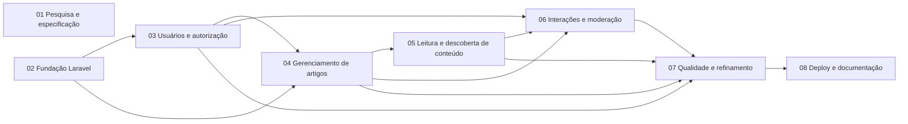

# ROADMAP — he4rt ink

**Atualizado em:** 19/11/2026  
**Escopo:** MVP aprovado (`REQUIREMENTS.md`, seção 8)  
**Tarefas:** 95 em 8 fases

Este documento descreve o plano: fases, dependências, entregáveis, critérios de conclusão e tarefas. O andamento real (status de cada tarefa, bloqueios e histórico) fica no workspace de acompanhamento do projeto. Requisitos estão em `REQUIREMENTS.md` e decisões em `DECISIONS.md`.

## Visão geral

| Fase | Nome                             | Depende de                         | Esforço relativo | Tarefas |
| ---- | -------------------------------- | ---------------------------------- | ---------------- | ------- |
| 01   | Pesquisa e especificação         | —                                  | Pequeno          | 9       |
| 02   | Fundação Laravel                 | —                                  | Médio            | 12      |
| 03   | Usuários e autorização           | Fase 02                            | Grande           | 12      |
| 04   | Gerenciamento de artigos         | Fase 02, Fase 03                   | Grande           | 12      |
| 05   | Leitura e descoberta de conteúdo | Fase 04                            | Médio            | 10      |
| 06   | Interações e moderação           | Fase 03, Fase 04, Fase 05          | Grande           | 16      |
| 07   | Qualidade e refinamento          | Fase 03, Fase 04, Fase 05, Fase 06 | Grande           | 10      |
| 08   | Deploy e documentação            | Fase 07                            | Médio            | 11      |

O esforço relativo é uma hipótese inicial. As estimativas em tempo ainda não foram feitas.

As setas mostram dependências entre fases inteiras. Algumas tarefas também dependem de tarefas específicas de outras fases; isso aparece na coluna "Depende de" de cada tabela.

**Categorias:** BE = Backend, FE = Frontend, DB = Banco de Dados, TS = Testes, AR = Arquitetura, DC = Documentação.

---

## Fase 01 — Pesquisa e especificação

**Objetivo:** Definir o funcionamento da aplicação e documentar suas regras antes de avançar no desenvolvimento.

Transforma o PROJECT.md em requisitos, regras e fluxos verificáveis. Também resolve as decisões pendentes que bloqueiam as fases técnicas.

**Depende de:** nenhuma.

**Esforço relativo:** Pequeno (hipótese). **Estimativa:** A estimar.

**Entregáveis**

- Requisitos funcionais
- Regras de negócio
- Fluxos principais
- Escopo documentado do MVP
- PRODUCT.md validado

**Critérios de conclusão**

- Requisitos dos quatro módulos revisados e numerados
- Estados e transições dos artigos aprovados, incluindo o caso de não aprovação
- Escopo do MVP fechado, com critérios de busca e filtros
- Banco decidido e escolhas técnicas restantes transferidas para a p2-08

A fase está concluída quando todas as tarefas estão concluídas e todos os critérios foram verificados.

**Tarefas**

| ID    | Tarefa                                          | Cat. | Prioridade | Depende de   | Critério de conclusão                                                                                                                                                |
| ----- | ----------------------------------------------- | ---- | ---------- | ------------ | -------------------------------------------------------------------------------------------------------------------------------------------------------------------- |
| p1-01 | Consolidar os requisitos funcionais             | DC   | Alta       | —            | REQUIREMENTS.md lista os requisitos por módulo, cada um com identificador.                                                                                           |
| p1-02 | Documentar os perfis de acesso                  | DC   | Alta       | p1-01        | Matriz perfil × ação documentada e revisada.                                                                                                                         |
| p1-03 | Documentar as regras de publicação              | DC   | Alta       | p1-01        | As nove regras escritas, cada uma com pelo menos um exemplo.                                                                                                         |
| p1-04 | Definir os estados dos artigos                  | AR   | Alta       | p1-03        | Estados e transições documentados; decisões D13 e D14 resolvidas.                                                                                                    |
| p1-05 | Definir os fluxos de criação e aprovação        | AR   | Alta       | p1-02, p1-04 | Fluxo documentado com ator e estado em cada passo.                                                                                                                   |
| p1-06 | Definir os requisitos de comentários e curtidas | DC   | Média      | p1-01        | Regras de unicidade e de acesso escritas em REQUIREMENTS.md.                                                                                                         |
| p1-07 | Definir o escopo do MVP                         | DC   | Alta       | p1-01, p1-06 | Lista MVP, depois do MVP e fora do escopo aprovada; campos de busca e critérios de filtro definidos (D15). A tecnologia de busca fica na p2-08.                      |
| p1-08 | Documentar decisões iniciais de arquitetura     | AR   | Média      | p1-05, p1-07 | Decisões iniciais de produto e de arquitetura registradas em DECISIONS.md com justificativa e alternativas descartadas. Escolhas técnicas transferidas para a p2-08. |
| p1-09 | Escrever o PRODUCT.md                           | DC   | Alta       | —            | Seções Register, Users e Product Purpose validadas; perguntas abertas resolvidas; Nível 2 do padrão conferido (um H1 e as seções canônicas obrigatórias).            |

---

## Fase 02 — Fundação Laravel

**Objetivo:** Estabelecer a estrutura técnica da aplicação.

Laravel 13 com React, Inertia, TypeScript e MariaDB integrados; temas, tokens de design e paleta acessível; i18n PT/EN; filas, agendador, e-mail e armazenamento prontos; ferramentas de teste configuradas. Inclui as quatro escolhas técnicas que ficaram da P1.

**Depende de:** nenhuma. Por tarefa, também de p1-08.

**Esforço relativo:** Médio (hipótese). **Estimativa:** A estimar.

**Entregáveis**

- Aplicação inicial funcional
- Backend, frontend e banco integrados
- DESIGN.md com tokens, temas e paleta do editor
- Infraestrutura de filas, e-mail e armazenamento
- Estrutura de testes preparada

**Critérios de conclusão**

- Aplicação sobe localmente com um passo a passo documentado
- Página Inertia em TypeScript recebe dados de um controller
- Paleta do editor verificada com contraste mínimo de 4,5:1 nos dois temas
- Fila, agendador e envio de e-mail funcionando localmente
- Pest e Vitest executam com sucesso
- Escolhas técnicas da seção 10.1 registradas em DECISIONS.md

A fase está concluída quando todas as tarefas estão concluídas e todos os critérios foram verificados.

**Tarefas**

| ID    | Tarefa                                                      | Cat. | Prioridade | Depende de   | Critério de conclusão                                                                                     |
| ----- | ----------------------------------------------------------- | ---- | ---------- | ------------ | --------------------------------------------------------------------------------------------------------- |
| p2-01 | Configurar o projeto Laravel 13                             | BE   | Alta       | —            | Aplicação sobe localmente e php artisan about roda sem erros.                                             |
| p2-02 | Configurar React, Inertia e TypeScript                      | FE   | Alta       | p2-01        | Página .tsx recebe props tipadas de um controller; checagem de tipos sem erros.                           |
| p2-03 | Configurar MariaDB                                          | DB   | Alta       | p2-01        | Migrations padrão rodam no banco local; .env.example documentado.                                         |
| p2-04 | Configurar Tailwind, tokens e temas claro e escuro          | FE   | Alta       | p2-02        | Troca de tema funciona e respeita a preferência do dispositivo.                                           |
| p2-05 | Criar o DESIGN.md com a paleta acessível do editor          | DC   | Alta       | p2-04        | Todas as combinações verificadas com contraste mínimo de 4,5:1 nos dois temas, com evidência.             |
| p2-06 | Preparar a internacionalização PT/EN                        | FE   | Alta       | p2-02        | Uma página funcionando nos dois idiomas, sem strings fixas.                                               |
| p2-07 | Configurar filas, agendador e envio de e-mail               | BE   | Alta       | p2-03        | Um job em fila, uma rotina agendada e um e-mail de teste executados localmente.                           |
| p2-08 | Decidir editor, imagens, busca, backup e mecanismo do admin | AR   | Alta       | p1-08        | Escolhas registradas em DECISIONS.md com justificativa e alternativas descartadas.                        |
| p2-09 | Configurar armazenamento de arquivos                        | BE   | Média      | p2-01, p2-08 | Arquivo privado inacessível por URL direta; arquivo público servido normalmente.                          |
| p2-10 | Organizar estrutura de pastas e padrões                     | AR   | Média      | p2-02        | Convenções registradas em ARCHITECTURE.md e ferramentas configuradas.                                     |
| p2-11 | Preparar Pest e Vitest                                      | TS   | Alta       | p2-02, p2-03 | Um teste Pest e um Vitest passam por um comando documentado.                                              |
| p2-12 | Testes de navegador com axe                                 | TS   | Alta       | p2-11        | Um teste Pest de navegador roda o axe numa tela e falha com violação "serious" ou "critical"; roda no CI. |

---

## Fase 03 — Usuários e autorização

**Objetivo:** Implementar contas, perfis de acesso e segurança das operações.

Cadastro com idade mínima e aceite das políticas, regras de username, verificação de e-mail, recuperação e troca de senha e e-mail, administrador da instalação com 2FA, perfis de acesso e Policies, perfil público e páginas de políticas.

**Depende de:** Fase 02. Por tarefa, também de p1-08.

**Esforço relativo:** Grande (hipótese). **Estimativa:** A estimar.

**Entregáveis**

- Cadastro, login e verificação de e-mail
- Administrador da instalação com 2FA
- Perfis de acesso e regras de autorização
- Perfil público e edição de perfil
- Páginas de Termos e políticas com aceite versionado
- Testes de permissões

**Critérios de conclusão**

- Os quatro perfis (visitante, não verificado, verificado, admin) são distinguíveis no backend
- Rotas e ações sensíveis negam acesso sem permissão
- Eventos de segurança registrados
- Testes de permissão executados e passando

A fase está concluída quando todas as tarefas estão concluídas e todos os critérios foram verificados.

**Tarefas**

| ID    | Tarefa                                                     | Cat. | Prioridade | Depende de          | Critério de conclusão                                                                                                        |
| ----- | ---------------------------------------------------------- | ---- | ---------- | ------------------- | ---------------------------------------------------------------------------------------------------------------------------- |
| p3-01 | Modelar usuários, perfis, políticas e eventos de segurança | DB   | Alta       | p2-03, p1-08        | Migrations reversíveis e campos documentados em DATABASE.md.                                                                 |
| p3-02 | Cadastro com idade mínima e aceite das políticas           | BE   | Alta       | p3-01, p2-06        | Cadastro registra data e versão aceita; sem a declaração, o cadastro é recusado.                                             |
| p3-03 | Aplicar as regras de username                              | BE   | Alta       | p3-01               | Usernames inválidos ou reservados são recusados com mensagem clara.                                                          |
| p3-04 | Login, logout, rate limiting e eventos de segurança        | BE   | Alta       | p3-01               | Tentativas repetidas são limitadas e registradas como eventos de segurança.                                                  |
| p3-05 | Verificação de e-mail e exclusão de contas não verificadas | BE   | Alta       | p3-02, p2-07        | Conta não verificada é excluída no 8º dia; username e e-mail ficam livres.                                                   |
| p3-06 | Recuperação de senha e troca de senha e de e-mail          | BE   | Alta       | p3-05               | O usuário segue verificado até confirmar o novo e-mail; avisos enviados.                                                     |
| p3-07 | Administrador da instalação com 2FA                        | BE   | Alta       | p3-04               | Admin não acessa o painel sem 2FA; códigos de recuperação funcionam.                                                         |
| p3-08 | Perfis de acesso e Policies                                | BE   | Alta       | p3-07               | Cada ação da seção 3 mapeada para uma regra de autorização (`ARCHITECTURE.md` §2.3; as Policies entram com cada fatia, D75). |
| p3-09 | Proteger rotas e validar permissões no backend             | BE   | Alta       | p3-08               | Visitante redirecionado ao login; usuário comum recebe 403 em rotas de admin.                                                |
| p3-10 | Perfil público e edição de perfil                          | FE   | Alta       | p3-03, p3-08, p2-09 | Perfil público exibido; edição validada; foto sem metadados.                                                                 |
| p3-11 | Páginas de Termos e políticas com aceite versionado        | FE   | Média      | p3-01, p2-06        | Nova versão publicada exige aceite no próximo login.                                                                         |
| p3-12 | Testar acesso por perfil                                   | TS   | Alta       | p3-09, p2-11        | Testes Pest executados e passando.                                                                                           |

---

## Fase 04 — Gerenciamento de artigos

**Objetivo:** Implementar o ciclo de escrita, versões e envio para aprovação.

Modelo de artigo e versão, editor Rich Text com paleta acessível, salvamento automático, prévia, imagens, categorias e tags, envio e retirada da fila, Meus artigos, lixeira e retenção de versões.

**Depende de:** Fase 02, Fase 03. Por tarefa, também de p1-04.

**Esforço relativo:** Grande (hipótese). **Estimativa:** A estimar.

**Entregáveis**

- Modelo de artigos e versões
- Editor Rich Text com prévia
- Upload de imagens
- Categorias e tags
- Envio, retirada e Meus artigos
- Lixeira e retenção de versões

**Critérios de conclusão**

- Autor cria, edita e envia o próprio artigo seguindo as transições da seção 5
- Versão enviada fica congelada e pode ser retirada
- Imagens de versões pendentes não são acessíveis publicamente
- Testes de gerenciamento executados e passando

A fase está concluída quando todas as tarefas estão concluídas e todos os critérios foram verificados.

**Tarefas**

| ID    | Tarefa                                                | Cat. | Prioridade | Depende de          | Critério de conclusão                                                                                                                 |
| ----- | ----------------------------------------------------- | ---- | ---------- | ------------------- | ------------------------------------------------------------------------------------------------------------------------------------- |
| p4-01 | Modelar artigos, versões e imagens                    | DB   | Alta       | p2-03, p1-04        | Migrations reversíveis conforme o modelo de dois estados. As tabelas de imagens entram com a p4-07 (D79).                             |
| p4-02 | Estados do artigo e da versão                         | BE   | Alta       | p4-01               | Transições inválidas rejeitadas e cobertas por teste.                                                                                 |
| p4-03 | Categorias e tags                                     | BE   | Alta       | p4-01, p3-08        | Categoria com artigos não é excluída sem transferência; tags duplicadas são unificadas.                                               |
| p4-04 | Criação e edição com rascunho e salvamento automático | BE   | Alta       | p4-02, p3-09        | Rascunho salvo automaticamente; não autor recebe 403. Salvamento por JSON, artigo criado no primeiro salvamento (D80).                |
| p4-05 | Editor Rich Text com paleta acessível                 | FE   | Alta       | p4-04, p2-05, p2-08 | Editor usa só cores da paleta; contagem de palavras e limites funcionando.                                                            |
| p4-06 | Prévia, sumário e tempo de leitura                    | FE   | Média      | p4-05               | Prévia e página pública produzem o mesmo resultado.                                                                                   |
| p4-07 | Upload de imagens                                     | BE   | Alta       | p4-01, p2-09, p2-07 | Imagens de versões pendentes só acessíveis ao autor e ao admin. Imagem pertence ao artigo; versões só a citam (D81).                  |
| p4-08 | Envio para aprovação e retirada da fila               | BE   | Alta       | p4-04, p4-07, p4-03 | Envio sem campos obrigatórios é recusado; retirada devolve a versão a rascunho; o envio mostra a estimativa de revisão (RF-377). D82. |
| p4-09 | Meus artigos                                          | FE   | Média      | p4-08               | Cada artigo aparece em uma única seção. Substitui o painel do kit inicial (D82).                                                      |
| p4-10 | Lixeira e exclusão permanente pelo autor              | BE   | Média      | p4-08               | Restauração em até 7 dias volta ao estado anterior; exclusão permanente auditada. A auditoria entra com a p6-15 (D82).                |
| p4-11 | Retenção de versões e limpeza de imagens sem uso      | BE   | Média      | p4-07, p2-07        | Rotina agendada remove o excedente sem afetar a versão em vigor. A limpeza de imagens sem uso já roda (D81).                          |
| p4-12 | Testar o gerenciamento de artigos                     | TS   | Alta       | p4-08, p4-10, p2-11 | Testes Pest executados e passando.                                                                                                    |

---

## Fase 05 — Leitura e descoberta de conteúdo

**Objetivo:** Disponibilizar a experiência pública de leitura e descoberta.

Regra única de visibilidade, página inicial, listagem, página de leitura, busca, filtros, ordenação por popularidade em período, perfil público com artigos e compartilhamento.

**Depende de:** Fase 04. Por tarefa, também de p2-04, p2-08, p2-10, p3-10.

**Esforço relativo:** Médio (hipótese). **Estimativa:** A estimar.

**Entregáveis**

- Regra única de visibilidade pública
- Página inicial e listagem
- Página de leitura
- Busca, filtros e ordenação
- Compartilhamento

**Critérios de conclusão**

- Somente artigos visíveis pela regra da seção 5.3 aparecem em qualquer página pública
- Ordenação padrão por curtidas dos últimos 30 dias
- Layout revisado em mobile e desktop, nos dois temas
- Testes de visibilidade executados e passando

A fase está concluída quando todas as tarefas estão concluídas e todos os critérios foram verificados.

**Tarefas**

| ID    | Tarefa                               | Cat. | Prioridade | Depende de          | Critério de conclusão                                                                                                                                                                                                                                                                                      |
| ----- | ------------------------------------ | ---- | ---------- | ------------------- | ---------------------------------------------------------------------------------------------------------------------------------------------------------------------------------------------------------------------------------------------------------------------------------------------------------- |
| p5-01 | Regra única de visibilidade pública  | BE   | Alta       | p4-02               | Uma única consulta reutilizada por todas as páginas públicas.                                                                                                                                                                                                                                              |
| p5-02 | Página inicial e listagem paginada   | FE   | Alta       | p5-01, p2-10        | Lista só artigos visíveis, sem consultas N+1.                                                                                                                                                                                                                                                              |
| p5-03 | Página de leitura                    | FE   | Alta       | p5-01, p4-06        | Artigo não visível retorna 404.                                                                                                                                                                                                                                                                            |
| p5-04 | Busca                                | BE   | Alta       | p5-01, p2-08        | Busca retorna só artigos visíveis.                                                                                                                                                                                                                                                                         |
| p5-05 | Filtros e ordenação por popularidade | BE   | Alta       | p5-01               | Ordenação padrão por curtidas dos últimos 30 dias.                                                                                                                                                                                                                                                         |
| p5-06 | Artigos no perfil público            | FE   | Média      | p5-01, p3-10        | Perfil oculto em carência ou suspensão.                                                                                                                                                                                                                                                                    |
| p5-07 | Compartilhamento                     | FE   | Baixa      | p5-03               | Botões funcionam no celular e no desktop.                                                                                                                                                                                                                                                                  |
| p5-08 | Layout editorial responsivo          | FE   | Média      | p5-02, p5-03, p2-04 | Verificado e registrado nas três larguras.                                                                                                                                                                                                                                                                 |
| p5-09 | Testar a visibilidade pública        | TS   | Alta       | p5-01, p5-04, p5-05 | Testes Pest executados e passando.                                                                                                                                                                                                                                                                         |
| p5-10 | Página de apresentação               | FE   | Média      | p5-02, p5-06        | Página em `/` com artigos visíveis, autores com artigo publicado e animações pausáveis; listagem em `/artigos` (RF-379 a RF-383). Feita antes das fatias 7 e 12: as seções com categorias, artigos e autores ficam ocultas até elas enviarem os dados, e os botões de leitura voltam com a fatia 12 (D74). |

---

## Fase 06 — Interações e moderação

**Objetivo:** Implementar interações, comunicação, moderação e o ciclo de vida das contas.

Comentários, curtidas, favoritos, notificações e e-mails; fila de aprovação, despublicação, denúncias e auditoria; suspensão, banimento, contestação, exclusão voluntária de conta e rotinas de retenção; painel administrativo.

**Depende de:** Fase 03, Fase 04, Fase 05. Por tarefa, também de p2-06, p2-07.

**Esforço relativo:** Grande (hipótese). **Estimativa:** A estimar.

**Entregáveis**

- Comentários, curtidas e favoritos
- Notificações internas e e-mails
- Fila de aprovação e despublicação
- Denúncias e auditoria
- Suspensão, banimento e contestação
- Exclusão voluntária de conta e retenção
- Painel administrativo

**Critérios de conclusão**

- Interações funcionam só para usuários verificados e respeitam os limites
- Aprovação, rejeição e despublicação citam o item da política e notificam o autor
- Penalidades, contestação e exclusão de conta seguem as seções 2.4 e 2.16 a 2.18
- Rotinas de retenção executam os prazos da seção 2.23
- Testes de interações e moderação passando

A fase está concluída quando todas as tarefas estão concluídas e todos os critérios foram verificados.

**Tarefas**

| ID    | Tarefa                                         | Cat. | Prioridade | Depende de                        | Critério de conclusão                                                                                                                                                     |
| ----- | ---------------------------------------------- | ---- | ---------- | --------------------------------- | ------------------------------------------------------------------------------------------------------------------------------------------------------------------------- |
| p6-01 | Comentários com respostas                      | BE   | Alta       | p5-03, p3-09                      | Visitante lê; só verificado comenta; limites aplicados.                                                                                                                   |
| p6-02 | Curtidas em artigos e comentários              | BE   | Alta       | p6-01                             | Curtida duplicada impedida pelo banco; autocurtida recusada.                                                                                                              |
| p6-03 | Favoritos                                      | BE   | Média      | p5-03, p3-09                      | Lista visível só ao dono; contagem atualizada.                                                                                                                            |
| p6-04 | Notificações internas                          | BE   | Alta       | p6-01, p6-02, p2-07               | Abrir o sino não marca como lida; curtidas agrupadas.                                                                                                                     |
| p6-05 | E-mails transacionais                          | BE   | Alta       | p2-07, p2-06                      | Cada e-mail com modelo nos dois idiomas, enviado por fila.                                                                                                                |
| p6-06 | Fila de aprovação, aprovação e rejeição        | BE   | Alta       | p4-08, p3-07                      | Decisão sobre versão retirada é recusada com aviso; versões com mais de 6 h aparecem como atrasadas (RF-378); desfazer a decisão em 10 s não apaga registro de auditoria. |
| p6-07 | Despublicação e exclusão permanente pelo admin | BE   | Alta       | p6-06                             | Despublicado volta ao autor pelo fluxo da rejeição.                                                                                                                       |
| p6-08 | Denúncias de artigos, comentários e perfis     | BE   | Alta       | p6-01, p3-10                      | Uma denúncia aberta por usuário e item; autodenúncia recusada.                                                                                                            |
| p6-09 | Auditoria das ações administrativas            | BE   | Alta       | p6-06                             | Nenhuma rota ou ação edita ou remove registros de auditoria.                                                                                                              |
| p6-10 | Suspensão                                      | BE   | Alta       | p6-08, p6-09                      | Na reativação, todo o conteúdo volta como estava.                                                                                                                         |
| p6-11 | Banimento                                      | BE   | Alta       | p6-10                             | Conta retida é excluída quando a contestação se encerra.                                                                                                                  |
| p6-12 | Contestação de penalidades                     | BE   | Alta       | p6-10, p6-11, p6-05               | Contestação aceita de suspensão exige autorização registrada para reativar.                                                                                               |
| p6-13 | Exclusão voluntária de conta                   | BE   | Alta       | p6-01, p6-02, p6-03, p4-10, p6-10 | Após 20 dias, artigos publicados ficam anonimizados e o resto é removido.                                                                                                 |
| p6-14 | Rotinas de retenção                            | BE   | Média      | p6-13, p6-08, p6-04               | Cada prazo da tabela coberto por uma rotina testada.                                                                                                                      |
| p6-15 | Painel administrativo e dashboard básico       | FE   | Média      | p6-06, p6-08, p4-03               | Painel acessível só ao admin com 2FA.                                                                                                                                     |
| p6-16 | Testar interações e moderação                  | TS   | Alta       | p6-02, p6-12, p6-13               | Testes Pest executados e passando.                                                                                                                                        |
| p6-17 | Bounces e reclamações de e-mail                | BE   | Alta       | p6-05                             | Webhook do provedor vira evento próprio (`EmailBounced`, `EmailComplained`); endereço que voltou deixa de receber e-mails (D71).                                          |
| p6-18 | Pedido de dados pessoais (LGPD)                | BE   | Alta       | p6-09, p2-07                      | Pedido sem login confirmado por e-mail em 24 h, com protocolo e atendimento pelo admin (RF-384 a RF-389).                                                                 |

---

## Fase 07 — Qualidade e refinamento

**Objetivo:** Garantir estabilidade, segurança, acessibilidade e privacidade.

Cobertura das regras de negócio, testes frontend, fluxos de ponta a ponta e revisões de acessibilidade, responsividade, i18n, segurança, erros, desempenho, privacidade e retenção.

**Depende de:** Fase 03, Fase 04, Fase 05, Fase 06.

**Esforço relativo:** Grande (hipótese). **Estimativa:** A estimar.

**Entregáveis**

- Suíte de testes consistente
- Fluxos principais validados
- Interface revisada (WCAG 2.2 AA, responsividade, PT/EN)
- Pendências críticas resolvidas

**Critérios de conclusão**

- Regras de negócio críticas cobertas por testes executados
- Nenhum item crítico aberto no controle de qualidade
- Acessibilidade, responsividade, i18n e privacidade revisadas com evidência

A fase está concluída quando todas as tarefas estão concluídas e todos os critérios foram verificados.

**Tarefas**

| ID    | Tarefa                                 | Cat. | Prioridade | Depende de                 | Critério de conclusão                                      |
| ----- | -------------------------------------- | ---- | ---------- | -------------------------- | ---------------------------------------------------------- |
| p7-01 | Cobrir as regras de negócio com testes | TS   | Alta       | p3-12, p4-12, p5-09, p6-16 | Cada regra crítica com ao menos um teste executado.        |
| p7-02 | Testes frontend com Vitest             | TS   | Alta       | p4-05, p5-03, p6-01        | Testes Vitest executados e passando.                       |
| p7-03 | Testar fluxos completos                | TS   | Alta       | p6-13, p7-01               | Fluxos de ponta a ponta executados.                        |
| p7-04 | Revisar acessibilidade (WCAG 2.2 AA)   | FE   | Alta       | p5-08, p6-15               | Checklist aplicado em todas as páginas, com evidência.     |
| p7-05 | Revisar responsividade                 | FE   | Média      | p5-08, p6-15               | Verificado e registrado.                                   |
| p7-06 | Validar PT/EN completo                 | FE   | Média      | p6-05, p7-05               | Nenhuma string fixa encontrada.                            |
| p7-07 | Revisar segurança                      | BE   | Alta       | p7-01                      | Cada item verificado e registrado.                         |
| p7-08 | Revisar erros e validações             | BE   | Média      | p6-16                      | Sem stack trace com APP_DEBUG desligado; mensagens claras. |
| p7-09 | Revisar desempenho e consultas         | DB   | Média      | p5-05, p6-14               | Listagens sem N+1; índices nas FKs e nos estados.          |
| p7-10 | Validar privacidade e retenção         | TS   | Média      | p6-14                      | Evidência registrada no controle de qualidade.             |

---

## Fase 08 — Deploy e documentação

**Objetivo:** Publicar a aplicação e finalizar a documentação.

Hospedagem, ambiente e banco de produção, deploy repetível, backup, textos das políticas, documentação técnica, README e apresentação para portfólio.

**Depende de:** Fase 07. Por tarefa, também de p2-08, p3-11.

**Esforço relativo:** Médio (hipótese). **Estimativa:** A estimar.

**Entregáveis**

- Aplicação publicada
- Backup configurado
- Textos de Termos e políticas publicados
- Documentação técnica e README
- Projeto preparado para apresentação

**Critérios de conclusão**

- Aplicação acessível em URL pública
- Fluxo completo validado em produção
- Backup testado com uma restauração
- Documentos revisados e README final publicado

A fase está concluída quando todas as tarefas estão concluídas e todos os critérios foram verificados.

**Tarefas**

| ID    | Tarefa                                                     | Cat. | Prioridade | Depende de          | Critério de conclusão                                                                                                                                                                                                                 |
| ----- | ---------------------------------------------------------- | ---- | ---------- | ------------------- | ------------------------------------------------------------------------------------------------------------------------------------------------------------------------------------------------------------------------------------- |
| p8-01 | Definir hospedagem, banco e provedor de e-mail de produção | AR   | Alta       | p2-08               | Hospedagem, banco e provedor de e-mail escolhidos com justificativa; fornecedores de e-mail comparados pelos critérios da D71, com prós, contras, custos e implicações técnicas. Hospedagem e banco decididos na D78; falta o e-mail. |
| p8-02 | Configurar o ambiente de produção                          | BE   | Alta       | p8-01               | Nenhum segredo versionado; filas e agendador ativos.                                                                                                                                                                                  |
| p8-03 | Preparar o banco de produção e o admin inicial             | DB   | Alta       | p8-02, p7-09        | Banco acessível só pela aplicação.                                                                                                                                                                                                    |
| p8-04 | Build e deploy repetível                                   | BE   | Alta       | p8-02, p7-02        | Deploy executado ao menos duas vezes.                                                                                                                                                                                                 |
| p8-05 | Configurar backup                                          | BE   | Alta       | p8-03, p2-08        | Uma restauração testada a partir do backup.                                                                                                                                                                                           |
| p8-06 | Validar a aplicação publicada                              | TS   | Alta       | p8-04, p8-05, p7-03 | Evidência registrada no controle de qualidade.                                                                                                                                                                                        |
| p8-07 | Publicar os textos de Termos e políticas                   | DC   | Alta       | p3-11               | Textos publicados com versão registrada.                                                                                                                                                                                              |
| p8-08 | Documentar arquitetura e banco                             | DC   | Média      | p7-01               | Diagramas e textos atualizados.                                                                                                                                                                                                       |
| p8-09 | Documentar instalação e configuração                       | DC   | Média      | p8-04               | Passo a passo seguido do início ao fim sem ajustes.                                                                                                                                                                                   |
| p8-10 | Finalizar o README                                         | DC   | Alta       | p8-06, p8-09        | README revisado e publicado.                                                                                                                                                                                                          |
| p8-11 | Preparar a apresentação para portfólio                     | DC   | Média      | p8-10               | Apresentação pronta com link e capturas.                                                                                                                                                                                              |
| p8-12 | Configurar o provedor de e-mail escolhido                  | BE   | Alta       | p8-01, p6-17        | SPF, DKIM e DMARC válidos; failover configurado; `mail:test` entregue pelo provedor (D71).                                                                                                                                            |

---

## Entrega por fatias

As tarefas acima são implementadas em **fatias**: cada fatia entrega uma funcionalidade de ponta a ponta, com o backend, as telas que dependem dele e os componentes de interface que essas telas usam pela primeira vez. Nenhuma tela é feita antes do seu backend, e nenhum componente é criado sem uma tela que o use. Cada fatia termina num PR próprio.

**Uma fatia está pronta quando:**

- O backend tem testes Pest passando.
- As telas são idênticas às pranchas do canvas de referência: medidas, espaçamentos, textos e estados vêm do HTML da prancha, e a captura da implementação é comparada lado a lado com a da prancha. Quando a prancha contraria uma decisão aprovada (`DECISIONS.md`), vale a decisão, e a diferença é informada na entrega.
- As telas funcionam em português e inglês, no desktop e no celular, nos temas claro e escuro.
- Os estados carregando, vazio, pronto e erro existem onde se aplicam.
- O axe não encontra violação "serious" ou "critical" (p2-12), e o contraste dos tokens usados está coberto pelos testes.
- Componentes de bibliotecas (shadcn/ui, Magic UI, Aceternity, Animate UI, React Bits) entram só como código-fonte do componente usado, com fonte e licença no topo do arquivo; nenhuma biblioteca de componentes é instalada como dependência e nenhum componente fica sem uso.

**Antes da primeira fatia:** p2-12 (axe), p2-10 (organização do código), p2-07 (filas, agendador e e-mail local) e, antes da fatia 6, p2-09 (armazenamento).

| Fatia                                 | Tarefas                                                  | Telas do canvas                                                                                      |
| ------------------------------------- | -------------------------------------------------------- | ---------------------------------------------------------------------------------------------------- |
| 1. Entrar                             | p3-04                                                    | Login, Login · mobile (limite de tentativas)                                                         |
| 2. Recuperar senha                    | p3-06 (senha)                                            | Recuperar senha, Link enviado · mobile                                                               |
| 3. Criar conta                        | p3-01, p3-02, p3-03, p3-05                               | Criar conta, Criar conta vindo de "Escrever", Confirmar e-mail, E-mail confirmado (desktop e mobile) |
| 4. Termos e políticas                 | p3-11                                                    | Novo aceite dos Termos (desktop e mobile) e páginas das políticas                                    |
| 5. Administradora                     | p3-07, p3-08, p3-09, p3-12                               | Ativação e desafio de 2FA, estrutura do admin                                                        |
| 6. Perfil e configurações             | p2-09, p3-06 (e-mail), p3-10                             | Configurações (desktop e mobile), Perfil sem artigos                                                 |
| 7. Categorias e tags                  | p4-01, p4-02, p4-03                                      | Admin · Categorias e tags                                                                            |
| 8. Editor                             | p4-04, p4-05, p4-06                                      | Editor, Editor vazio, Prévia, Detalhes do artigo · mobile                                            |
| 9. Imagens                            | p4-07                                                    | Capa e imagens no editor                                                                             |
| 10. Envio e Meus artigos              | p4-08, p4-09, p4-10, p4-12                               | Meus artigos (desktop e mobile)                                                                      |
| 11. Retenção de versões               | p4-11                                                    | —                                                                                                    |
| 12. Listagem e leitura                | p5-01, p5-02, p5-03, p5-08                               | Home, Leitura, Página não encontrada (404)                                                           |
| 13. Busca                             | p5-04, p5-05, p5-09                                      | Busca com filtros, Busca sem resultados, filtros em bottom sheet                                     |
| 14. Perfil com artigos e compartilhar | p5-06, p5-07                                             | Perfil do autor, Compartilhar artigo                                                                 |
| 15. Página de apresentação            | p5-10                                                    | Landing page (desktop e mobile)                                                                      |
| 16. Moderação                         | p6-05 (aprovação e rejeição), p6-06, p6-07, p6-09, p6-15 | Admin · Painel, Fila de aprovação, Revisão de versão, Auditoria                                      |
| 17. Comentários e curtidas            | p6-01, p6-02                                             | Comentários · logada (desktop e mobile)                                                              |
| 18. Favoritos                         | p6-03                                                    | Favoritos, Favoritos vazio                                                                           |
| 19. Notificações                      | p6-04, p6-05, p6-17                                      | Notificações, menu do sino, Notificações vazias                                                      |
| 20. Denúncias                         | p6-08                                                    | Denunciar artigo, Admin · Denúncias                                                                  |
| 21. Penalidades e contestação         | p6-10, p6-11, p6-12                                      | Admin · Usuário e penalidade, Contestações, Conta suspensa, Contestar suspensão                      |
| 22. Exclusão de conta                 | p6-13                                                    | Excluir conta, Exclusão solicitada, Cancelar exclusão                                                |
| 23. Username obrigatório e retenção   | p6-14, p6-16                                             | Trocar username obrigatório                                                                          |
| 24. Pedido de dados (LGPD)            | p6-18                                                    | Pedido de dados, Pedido · erros, Pedido recebido (desktop e mobile)                                  |

As pranchas "Escuro" do canvas servem de conferência: no código, o tema é uma variável, não uma tela.

---

## Regras do plano

- Nenhuma tarefa começa concluída e nenhum progresso é registrado por suposição.
- Uma tarefa bloqueada não pode ser concluída.
- Uma tarefa só é concluída quando suas dependências estão concluídas; concluir uma dependência não conclui a tarefa.
- Funcionalidades fora do MVP (`REQUIREMENTS.md`, seções 8.2 e 8.3) não entram neste roadmap.
- Mudanças de escopo passam por `DECISIONS.md` antes de alterar este documento.
